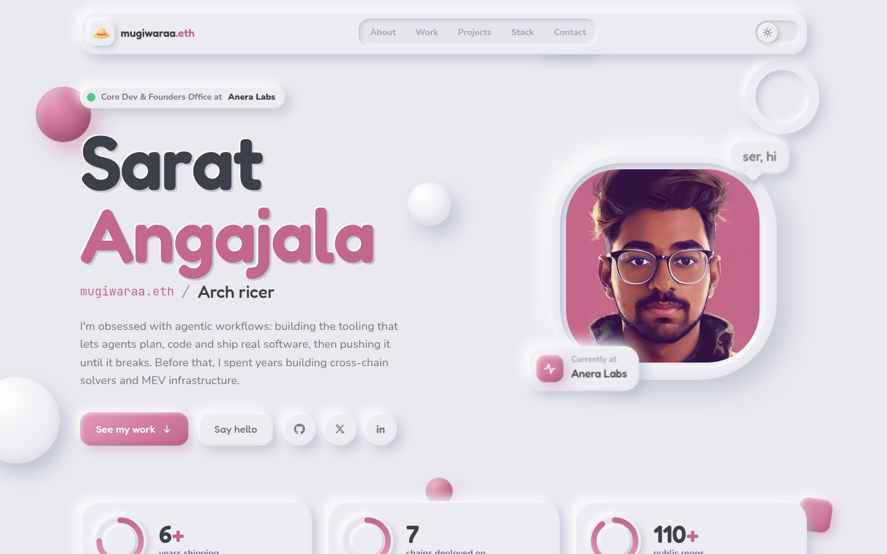
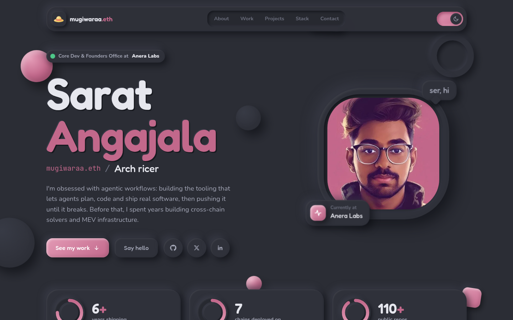
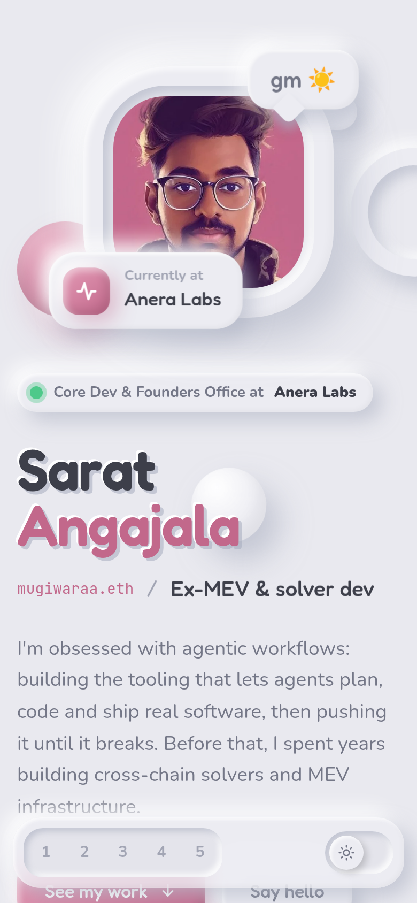
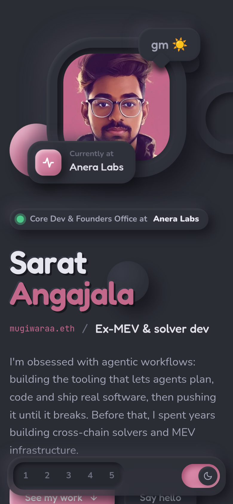
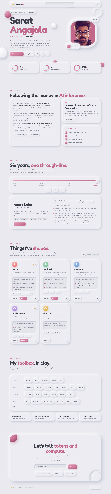

# smugiwara.com

Personal portfolio of Sarat Angajala (mugiwaraa.eth), built with a claymorphism design language.

**Stack:** Next.js (App Router, static export) · Tailwind CSS v4 · Framer Motion

## Screenshots

| Light | Dark |
| --- | --- |
|  |  |

<p align="center">
  
  &nbsp;&nbsp;
  
</p>

<details>
<summary>Full page</summary>



</details>

## Develop

```sh
pnpm install
pnpm dev        # http://localhost:3000
pnpm build      # static site in ./out
pnpm start      # serve ./out locally
```

## Editing content

All copy (bio, jobs, projects, stack, links) lives in `src/lib/content.ts`.
Set `profile.email` there to show an email button in the contact section.

## Design system

Clay tokens live in `src/app/globals.css`: surfaces, shadows (`shadow-raised`, `shadow-pressed`, `shadow-accent`)
and the accent palette. The theme (light/dark) is toggled via `data-theme` on `<html>` and persisted in localStorage.
The accent is set at build time with `NEXT_PUBLIC_ACCENT` (`orchid` (default, matched to the profile photo), `coral`, `graphite` or `pacific`), e.g. in `.env.local`.

## Deploy

`pnpm build` emits a fully static site in `out/`, so it can be hosted on any static host (GitHub Pages,
Cloudflare Pages, Netlify, Vercel). `public/CNAME` is already set to `smugiwara.com` for GitHub Pages.

### Docker / homelab

Every push to `main` builds a multi-arch (amd64 + arm64) nginx image and pushes it to GHCR
(`.github/workflows/docker.yml`). Tags: `latest` (main), `sha-<short>`, and `X.Y.Z` / `X.Y` for `vX.Y.Z` git tags.
Set the repo variable `NEXT_PUBLIC_ACCENT` to change the accent baked into the image.

```yaml
# compose.yaml
services:
  portfolio:
    image: ghcr.io/saratangajalaoffl/portfolio-27:latest
    ports:
      - "8080:8080"
    restart: unless-stopped
```

Build locally with `docker build -t portfolio .` and run with `docker run -p 8080:8080 portfolio`.
